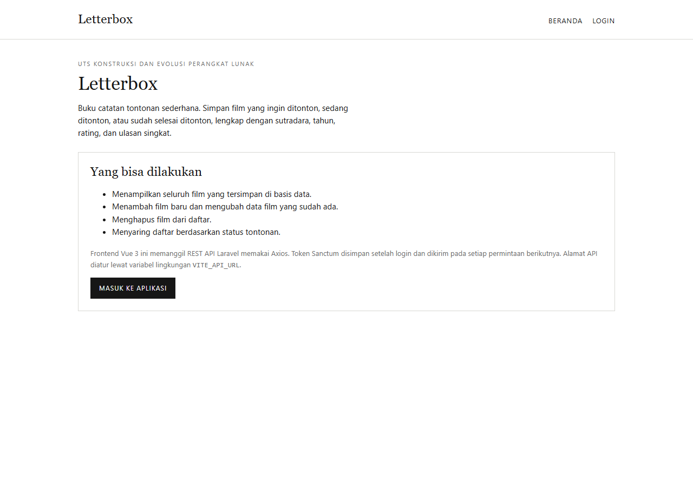
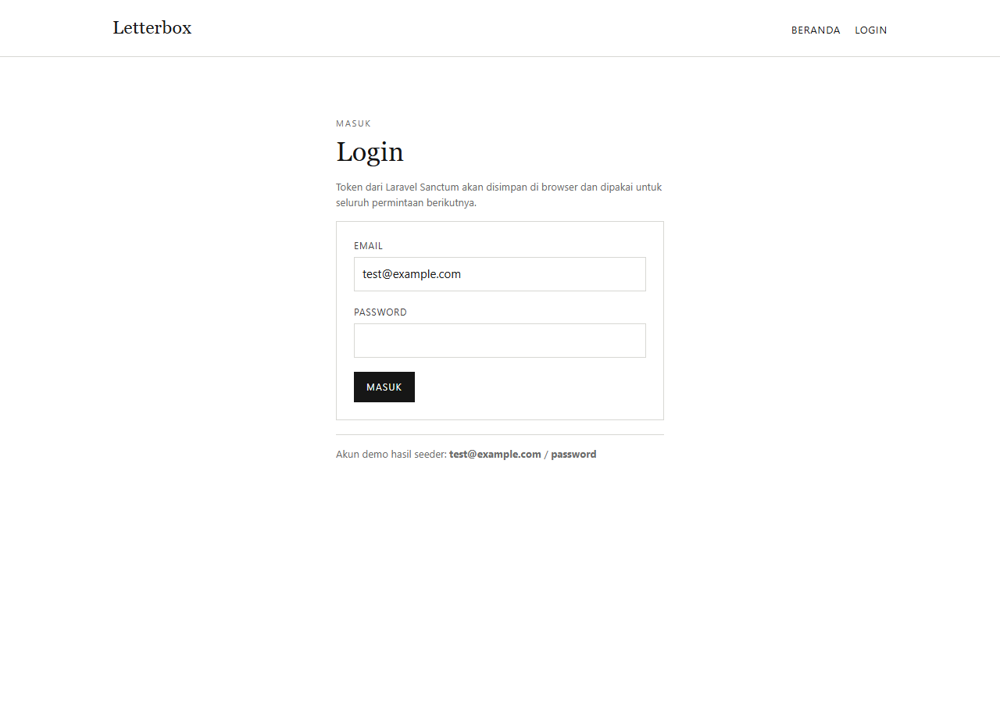
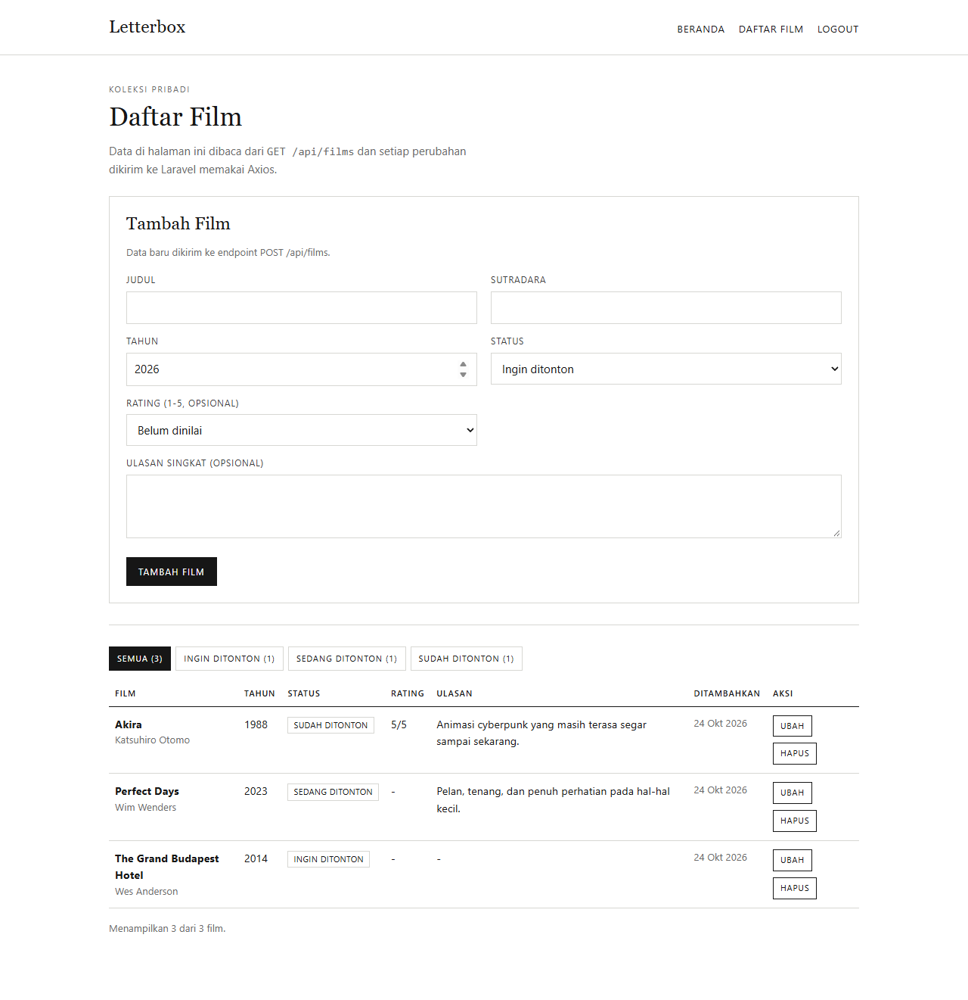
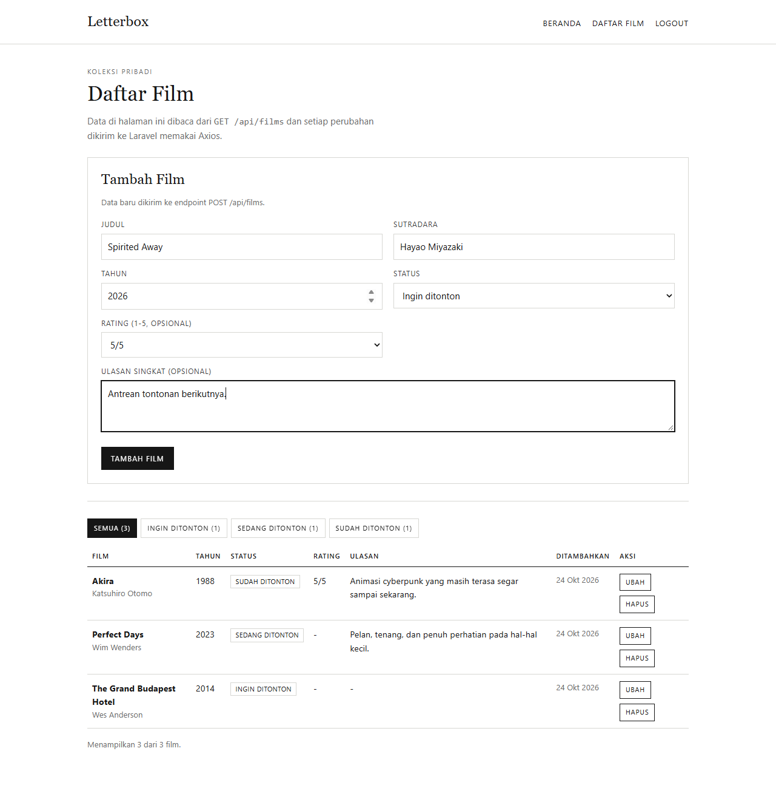
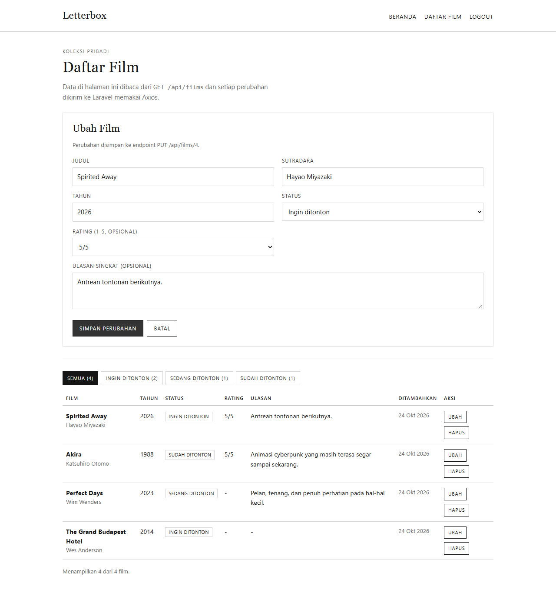
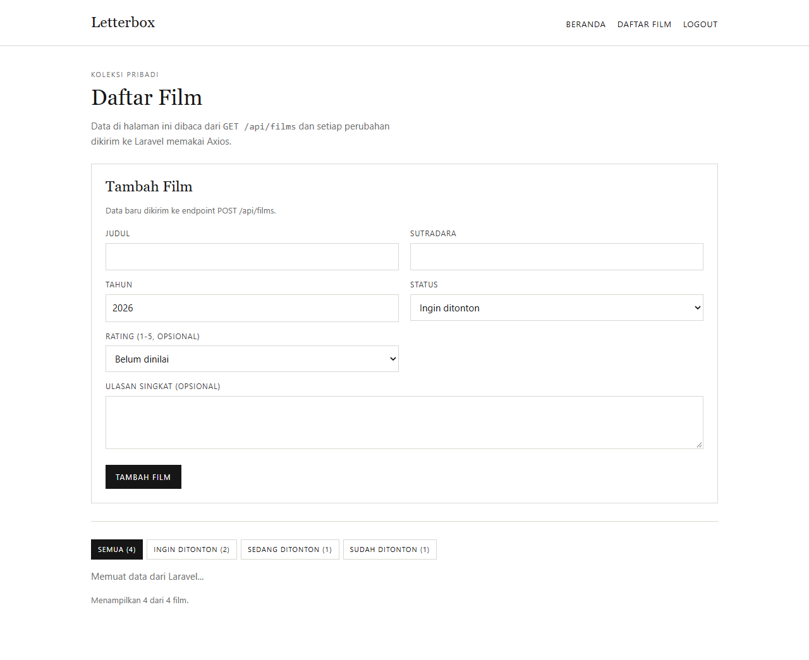

# LAPORAN UTS

## KONSTRUKSI DAN EVOLUSI PERANGKAT LUNAK

**Letterbox — Aplikasi Buku Catatan Tontonan**

```
Nama        : Mutia Umniati Z
NIM         : 24/535316/SV/24196
Kelas       : PL5AA
Dosen       : Galih Malela Damaraji
```

PROGRAM STUDI D-IV TEKNOLOGI REKAYASA PERANGKAT LUNAK
DEPARTEMEN TEKNIK ELEKTRO DAN INFORMATIKA
SEKOLAH VOKASI
UNIVERSITAS GADJAH MADA
YOGYAKARTA
2026

---

**Tautan repository:** <https://github.com/ttiauzm/uts-pi-24-535316-sv-24196>

**Postman Collection:** `postman/letterbox-api.postman_collection.json`

> Catatan: ganti seluruh penanda **[SCREENSHOT …]** dengan tangkapan layar asli sebelum
> mengekspor laporan ke PDF. Perintah untuk menghasilkan setiap bukti dicantumkan pada
> bagian terkait dan pada Lampiran B.

---

## Daftar Isi

1. [Ringkasan Pengerjaan](#1-ringkasan-pengerjaan)
2. [Backend Laravel (CPMK1)](#2-backend-laravel-cpmk1)
3. [Frontend Vue + Axios (CPMK1)](#3-frontend-vue--axios-cpmk1)
4. [Pengelolaan GitHub (CPMK2)](#4-pengelolaan-github-cpmk2)
5. [Continuous Deployment (CPMK3)](#5-continuous-deployment-cpmk3)
6. [Dockerfile Backend dan Frontend (CPMK4 & CPMK5)](#6-dockerfile-backend-dan-frontend-cpmk4--cpmk5)
7. [Docker Compose (CPMK6 & CPMK7)](#7-docker-compose-cpmk6--cpmk7)
8. [FrankenPHP (Nilai Tambahan)](#8-frankenphp-nilai-tambahan)
9. [Alur Data Vue → Laravel → MySQL](#9-alur-data-vue--laravel--mysql)
10. [Kendala dan Cara Mengatasinya](#10-kendala-dan-cara-mengatasinya)
11. [Kesesuaian dengan Kriteria Penilaian](#11-kesesuaian-dengan-kriteria-penilaian)
12. [Daftar Pustaka](#12-daftar-pustaka)
13. [Lampiran](#13-lampiran)

---

## 1. Ringkasan Pengerjaan

Tugas sebelumnya adalah CRUD **catatan (notes)**. Agar tidak sama, proyek ini mengganti tema
menjadi **Letterbox**, yaitu buku catatan tontonan film. Satu film menyimpan judul, sutradara,
tahun, status tontonan (`ingin_ditonton`, `sedang_ditonton`, `sudah_ditonton`), rating 1–5,
dan ulasan singkat.

Sistem terdiri atas tiga bagian yang dijalankan bersama dengan Docker Compose:

| Bagian | Teknologi | Port |
|---|---|---|
| Frontend | Vue 3 + Vite + Axios, disajikan Nginx | 8080 |
| Backend | Laravel 12 + Sanctum, server FrankenPHP | 8000 |
| Basis data | MySQL 8.4, volume `db_data` | internal |

Seluruh kode berada dalam satu repository dengan struktur `backend/` dan `frontend/`.
Perubahan masuk ke `main`/`dev` melalui Pull Request, diuji oleh GitHub Actions, lalu image
Docker di-push ke GitHub Container Registry (GHCR) dengan tag commit SHA.

---

## 2. Backend Laravel (CPMK1)

### 2.1 Laravel Sanctum dan autentikasi token

Sanctum dipakai dalam mode **API token**. Alurnya:

1. Klien mengirim `POST /api/login` berisi `email` dan `password`.
2. Laravel membandingkan password dengan hash di tabel `users`.
3. Jika valid, `createToken()` membuat token. Teks token hanya dikirim sekali; di basis data
   yang disimpan adalah hash-nya pada tabel `personal_access_tokens`.
4. Klien mengirim header `Authorization: Bearer <token>` pada setiap permintaan berikutnya.
5. Middleware `auth:sanctum` memeriksa token. Jika tidak ada/tidak valid, server membalas
   **401** JSON `{"message":"Unauthenticated."}`.
6. `POST /api/logout` menghapus token yang sedang dipakai.

Satu-satunya endpoint publik adalah login. Endpoint `register` ikut dilindungi token agar
sesuai dengan ketentuan “seluruh endpoint selain login hanya dapat diakses dengan token”.
Akun awal disediakan oleh seeder (`test@example.com` / `password`).

**Kode `AuthController` (bagian login):**

```php
$user = User::where('email', $validated['email'])->first();

if (! $user || ! Hash::check($validated['password'], $user->password)) {
    return response()->json(['message' => 'Email atau password salah.'], 401);
}

$token = $user->createToken('api-token')->plainTextToken;

return response()->json([
    'message' => 'Login berhasil.',
    'user' => $user,
    'token' => $token,
    'token_type' => 'Bearer',
]);
```

### 2.2 Endpoint REST

Seluruh endpoint berada di bawah prefiks `/api` dan selalu membalas JSON.

| Method | Endpoint | Auth | Fungsi | Status yang mungkin |
|---|---|---|---|---|
| POST | `/login` | publik | Login, mengembalikan token | 200, 401, 422 |
| GET | `/me` | Bearer | Data pengguna aktif | 200, 401 |
| POST | `/logout` | Bearer | Hapus token aktif | 200, 401 |
| POST | `/register` | Bearer | Buat akun baru | 201, 401, 422 |
| GET | `/films` | Bearer | Tampil semua film | 200, 401 |
| POST | `/films` | Bearer | Tambah film | 201, 401, 422 |
| GET | `/films/{id}` | Bearer | Tampil satu film | 200, 401, 404 |
| PUT/PATCH | `/films/{id}` | Bearer | Ubah film | 200, 401, 404, 422 |
| DELETE | `/films/{id}` | Bearer | Hapus film | 200, 401, 404 |

Resource utama adalah `films` dengan CRUD lengkap. Data tersimpan di tabel `films`
(migrasi `2026_01_01_000000_create_films_table.php`).

**Kode `routes/api.php`:**

```php
Route::post('/login', [AuthController::class, 'login']);

Route::middleware('auth:sanctum')->group(function () {
    Route::get('/me', [AuthController::class, 'me']);
    Route::post('/logout', [AuthController::class, 'logout']);
    Route::post('/register', [AuthController::class, 'register']);

    Route::apiResource('films', FilmController::class);
});
```

### 2.3 Validasi

Validasi dilakukan di server sebelum data menyentuh basis data. Aturan untuk `films`:

```php
'title'    => ['required', 'string', 'max:255'],
'director' => ['required', 'string', 'max:255'],
'year'     => ['required', 'integer', 'between:1888,'.(date('Y') + 5)],
'status'   => ['required', Rule::in(Film::STATUSES)],
'rating'   => ['nullable', 'integer', 'between:1,5'],
'review'   => ['nullable', 'string', 'max:1000'],
```

Jika gagal, Laravel membalas **422 Unprocessable Content**:

```json
{
  "message": "The title field is required. (and 4 more errors)",
  "errors": {
    "title": ["The title field is required."],
    "year": ["The year field must be between 1888 and 2031."],
    "status": ["The selected status is invalid."]
  }
}
```

Frontend membaca `errors` melalui `pesanError()` lalu menampilkannya sebagai satu kalimat.

### 2.4 Feature test

Perintah:

```bash
cd backend && php artisan test
```

Hasil nyata di mesin pengembang:

```
PASS  Tests\Unit\ExampleTest
PASS  Tests\Feature\Api\AuthApiTest
  ✓ login dengan kredensial benar mengembalikan token
  ✓ login dengan password salah ditolak 401
  ✓ login validasi gagal 422
  ✓ me tanpa token 401 dan dengan token 200
  ✓ logout menghapus token yang dipakai
  ✓ register bukan endpoint publik
  ✓ register oleh pengguna terautentikasi membuat user baru 201
PASS  Tests\Feature\Api\FilmApiTest
  ✓ tanpa token semua endpoint films ditolak 401
  ✓ tanpa token dan tanpa header accept tetap 401 json
  ✓ index mengembalikan daftar film json
  ✓ store membuat film baru 201
  ✓ store validasi gagal 422
  ✓ show mengembalikan satu film
  ✓ show film tidak ada mengembalikan 404 json
  ✓ update mengubah film
  ✓ update validasi gagal 422
  ✓ destroy menghapus film
PASS  Tests\Feature\ExampleTest

Tests: 19 passed (75 assertions)
```

> **[SCREENSHOT 2.1]** Terminal menjalankan `php artisan test` dan menampilkan
> `Tests: 19 passed`.

### 2.5 Daftar route

Perintah `php artisan route:list --path=api` menghasilkan:

```
GET|HEAD   api/films ............... films.index › Api\FilmController@index
POST       api/films ............... films.store › Api\FilmController@store
GET|HEAD   api/films/{film} ........ films.show › Api\FilmController@show
PUT|PATCH  api/films/{film} ........ films.update › Api\FilmController@update
DELETE     api/films/{film} ........ films.destroy › Api\FilmController@destroy
POST       api/login ............... Api\AuthController@login
POST       api/logout .............. Api\AuthController@logout
GET|HEAD   api/me .................. Api\AuthController@me
POST       api/register ............ Api\AuthController@register
```

> **[SCREENSHOT 2.2]** Output `php artisan route:list --path=api`.

### 2.6 Pengujian dengan Postman

Koleksi: `postman/letterbox-api.postman_collection.json` (12 request). Variabel koleksi:
`baseUrl = http://localhost:8000/api`, `token`, dan `filmId`.

Request login memiliki test script yang otomatis menyimpan token:

```javascript
pm.test('status 200 OK', () => pm.response.to.have.status(200));
const data = pm.response.json();
pm.expect(data).to.have.property('token');
if (data.token) pm.collectionVariables.set('token', data.token);
```

Request `store` menyimpan `filmId`, sehingga `show`, `update`, dan `destroy` langsung memakai
ID tersebut.

> **[SCREENSHOT 2.3]** Postman `POST /api/login` → **200 OK**, body berisi `token` dan
> `token_type: Bearer`.
>
> **[SCREENSHOT 2.4]** Postman `GET /api/films` tanpa token → **401 Unauthorized**
> `{"message":"Unauthenticated."}`.
>
> **[SCREENSHOT 2.5]** Postman `POST /api/films` → **201 Created** dengan body film baru.
>
> **[SCREENSHOT 2.6]** Postman `POST /api/films` dengan data tidak valid → **422** dan
> `errors.title`.
>
> **[SCREENSHOT 2.7]** Postman `PUT /api/films/{id}` → **200 OK** dengan data terbaru.
>
> **[SCREENSHOT 2.8]** Postman `DELETE /api/films/{id}` → **200 OK**
> `{"message":"Film berhasil dihapus."}`.

---

## 3. Frontend Vue + Axios (CPMK1)

Frontend berada di `frontend/`, memakai Vue 3, Vue Router, Axios, dan Vite. Tampilan sengaja
dibuat sederhana: hitam-putih, garis tipis, tanpa gradasi dan tanpa ornamen berlebihan.

### 3.1 Menyimpan dan mengirim token

`src/api/http.js` memusatkan seluruh komunikasi HTTP:

```javascript
export const http = axios.create({
  baseURL: import.meta.env.VITE_API_URL || '/api',
  headers: { Accept: 'application/json' },
})

http.interceptors.request.use((config) => {
  const token = localStorage.getItem(TOKEN_KEY)
  if (token) config.headers.Authorization = `Bearer ${token}`
  return config
})
```

- Setelah login berhasil, token disimpan di `localStorage` dengan kunci `letterbox_token`.
- Request interceptor menambahkan header `Authorization` pada setiap permintaan.
- Response interceptor menghapus token dan mengarahkan ke `/login` jika menerima 401
  (kecuali 401 dari proses login itu sendiri).

### 3.2 Alamat API tidak ditulis di komponen

Alamat API berasal dari **variabel lingkungan** `VITE_API_URL` (lihat `frontend/.env.example`).
Tidak ada URL backend yang di-hardcode di dalam komponen Vue.

- Saat development, `VITE_API_URL=/api` dan Vite mem-proxy `/api` ke
  `VITE_DEV_API_TARGET` (default `http://127.0.0.1:8000`).
- Saat produksi (Docker), `VITE_API_URL=/api`; Nginx meneruskan `/api` ke
  **`http://backend:8000`** memakai nama service Docker.

### 3.3 Halaman CRUD

| Halaman | Berkas | Fungsi |
|---|---|---|
| Beranda | `src/views/HomeView.vue` | Penjelasan aplikasi dan tautan login |
| Login | `src/views/LoginView.vue` | Form email/password, menyimpan token |
| Daftar Film | `src/views/FilmsView.vue` | Tabel, filter status, form tambah/ubah, hapus |

Operasi yang dipanggil:

```javascript
export const getFilms = () => http.get('/films').then((r) => r.data)
export const createFilm = (payload) => http.post('/films', payload).then((r) => r.data)
export const updateFilm = (id, payload) => http.put(`/films/${id}`, payload).then((r) => r.data)
export const deleteFilm = (id) => http.delete(`/films/${id}`).then((r) => r.data)
```



*Gambar 3.1 — Halaman Beranda Letterbox.*



*Gambar 3.2 — Halaman Login. Token disimpan setelah kredensial valid.*



*Gambar 3.3 — Daftar film setelah login; tiga data berasal dari seeder.*



*Gambar 3.4 — Form “Tambah Film” sedang diisi.*


*Gambar 3.5 — Setelah tambah: film baru muncul di tabel (respons 201).*



*Gambar 3.6 — Mode “Ubah Film” dengan data lama terisi.*


*Gambar 3.7 — Setelah ubah: isi tabel berubah (respons 200).*

> **[SCREENSHOT 3.8]** Dialog konfirmasi hapus (dialog bawaan browser; ambil manual
> saat mengklik tombol **Hapus**).



*Gambar 3.9 — Setelah hapus: film hilang dari tabel (respons 200).*

### 3.4 DevTools

> **[SCREENSHOT 3.10]** Tab **Network → Fetch/XHR** pada DevTools: request `POST /api/films`
> dengan header `Authorization: Bearer …`, payload JSON, dan response **201**.
>
> **[SCREENSHOT 3.11]** Tab **Application → Local Storage**: token tersimpan pada kunci
> `letterbox_token`.

### 3.5 Build frontend

```bash
cd frontend && npm ci && npm run build
```

Hasil nyata:

```
dist/index.html                   0.39 kB │ gzip:  0.27 kB
dist/assets/index-*.css           3.77 kB │ gzip:  1.36 kB
dist/assets/index-*.js          157.16 kB │ gzip: 59.68 kB
✓ built in 1.01s
```

> **[SCREENSHOT 3.12]** Output `npm run build` yang berhasil.

---

## 4. Pengelolaan GitHub (CPMK2)

### 4.1 Repository dan struktur

Repository publik: **`uts-pi-24-535316-sv-24196`**
(<https://github.com/ttiauzm/uts-pi-24-535316-sv-24196>), berisi dua folder utama:

```
backend/    -> Laravel 12
frontend/   -> Vue 3
```

> **[SCREENSHOT 4.1]** Halaman utama repository yang menampilkan folder `backend/` dan
> `frontend/`, serta status publik.

### 4.2 Branch

Branch yang digunakan:

- `main` — branch stabil, sumber deploy.
- `dev` — integrasi fitur.
- `feature/letterbox` — pengembangan fitur Letterbox.

Alur: `feature/*` → PR ke `dev` → PR `dev` ke `main`.

> **[SCREENSHOT 4.2]** Halaman **Branches** yang menampilkan ketiga branch.

### 4.3 Pull Request

> **[SCREENSHOT 4.3]** Daftar Pull Request yang sudah *merged* (fitur → `dev`, lalu
> `dev` → `main`), masing-masing dengan tanda centang hijau status check.

### 4.4 Branch protection

Ruleset dipasang pada `main` dan `dev` (`protect-main`, `protect-dev`) dengan aturan:

- Require a pull request before merging.
- Require status checks to pass: `Backend (Laravel test)` dan `Frontend (npm ci + build)`.
- Block force pushes.
- Restrict deletions.

> **[SCREENSHOT 4.4]** **Settings → Rules** menampilkan ruleset `protect-main` dan
> `protect-dev` berstatus *Active*.
>
> **[SCREENSHOT 4.5]** Halaman edit ruleset yang menunjukkan aturan *Require a pull request*
> dan dua status check yang diwajibkan.
>
> **[SCREENSHOT 4.6]** Bukti push langsung ke `main` ditolak
> (`GH006: Protected branch update failed`).

### 4.5 GitHub Actions

Workflow `.github/workflows/ci.yml` memiliki tiga job:

| Job | Trigger | Isi |
|---|---|---|
| `Backend (Laravel test)` | push & PR | `composer install`, `php artisan test` |
| `Frontend (npm ci + build)` | push & PR | `npm ci`, lint, unit test, `npm run build` |
| `Deploy (build & push GHCR)` | **hanya push ke `main`** | build & push dua image |

> **[SCREENSHOT 4.7]** Tab **Actions** dengan workflow CI/CD berwarna hijau.

Bukti daring (dapat dibuka langsung):

- Workflow CI/CD: <https://github.com/ttiauzm/uts-pi-24-535316-sv-24196/actions/workflows/ci.yml>
- Run `main` dengan job deploy hijau:
  <https://github.com/ttiauzm/uts-pi-24-535316-sv-24196/actions/runs/40058911795>
  (commit `5541813`)
- Run Pull Request / `dev` tanpa deploy:
  <https://github.com/ttiauzm/uts-pi-24-535316-sv-24196/actions/runs/40058850949>

---

## 5. Continuous Deployment (CPMK3)

### 5.1 Job deploy hanya untuk `main`

```yaml
deploy:
  name: Deploy (build & push GHCR)
  runs-on: ubuntu-latest
  needs: [backend, frontend]
  if: github.event_name == 'push' && github.ref == 'refs/heads/main'
```

Karena kondisi tersebut, workflow pada Pull Request, branch `dev`, dan branch fitur berhenti
setelah job pengujian dan build. Job deploy berstatus *skipped*.

> **[SCREENSHOT 5.1]** Run workflow pada `main`: ketiga job hijau, termasuk **Deploy**.
> Bukti: <https://github.com/ttiauzm/uts-pi-24-535316-sv-24196/actions/runs/40058911795>
>
> **[SCREENSHOT 5.2]** Run workflow pada `dev` atau PR: dua job hijau dan job **Deploy**
> berstatus *skipped*.
> Bukti: <https://github.com/ttiauzm/uts-pi-24-535316-sv-24196/actions/runs/40058850949>

### 5.2 Rahasia di GitHub Secrets

Nilai rahasia disimpan di **Settings → Secrets and variables → Actions**:

| Secret | Dipakai untuk |
|---|---|
| `APP_KEY` | kunci Laravel pada job backend dan validasi Compose |
| `DB_PASSWORD` | password MySQL user aplikasi |
| `DB_ROOT_PASSWORD` | password root MySQL |
| `VITE_API_URL` | opsional, nilai build frontend |

Tidak ada nilai rahasia di repository, Dockerfile, maupun `docker-compose.yml`. Berkas `.env`
yang berisi nilai sebenarnya masuk `.gitignore`; hanya `.env.example` yang di-commit.

> **[SCREENSHOT 5.3]** Halaman daftar secrets (nilai tersembunyi).
>
> **[SCREENSHOT 5.4]** Halaman pembuatan salah satu secret.

### 5.3 Build dan push image ke GHCR

```yaml
- name: Build & push image backend
  uses: docker/build-push-action@v6
  with:
    context: ./backend
    file: ./backend/Dockerfile
    push: true
    tags: ${{ env.IMAGE_PREFIX }}-backend:${{ github.sha }}

- name: Build & push image frontend
  uses: docker/build-push-action@v6
  with:
    context: ./frontend
    file: ./frontend/Dockerfile
    push: true
    build-args: |
      VITE_API_URL=${{ secrets.VITE_API_URL || '/api' }}
    tags: ${{ env.IMAGE_PREFIX }}-frontend:${{ github.sha }}
```

Tag memakai **nomor commit** (`github.sha`), bukan `latest`. Tag yang benar-benar di-push pada
run `main` commit `5541813`:

```
ghcr.io/ttiauzm/uts-pi-24-535316-sv-24196-backend:5541813c340dfa67b98659718751f6054cfbf710
ghcr.io/ttiauzm/uts-pi-24-535316-sv-24196-frontend:5541813c340dfa67b98659718751f6054cfbf710
```

> **[SCREENSHOT 5.5]** Halaman **Packages** yang menampilkan dua image:
> `…-backend` dan `…-frontend`, dengan tag commit SHA.
> Buka <https://github.com/ttiauzm?tab=packages>.
>
> **[SCREENSHOT 5.6]** Detail salah satu package yang menunjukkan tag SHA.

---

## 6. Dockerfile Backend dan Frontend (CPMK4 & CPMK5)

### 6.1 Backend (`backend/Dockerfile`)

Image dasar memakai versi eksplisit:

- `composer:2.9.8` untuk tahap dependensi.
- `dunglas/frankenphp:1.13.3-php8.3-alpine` untuk runtime.

Urutan layer mengikuti prinsip cache:

```dockerfile
FROM composer:2.9.8 AS vendor
WORKDIR /app

COPY composer.json composer.lock ./
RUN composer install --no-dev --prefer-dist --no-interaction --no-progress \
    --no-scripts --no-autoloader --ignore-platform-reqs

COPY . .
RUN composer dump-autoload --optimize --no-dev --no-scripts

FROM dunglas/frankenphp:1.13.3-php8.3-alpine AS runtime
RUN install-php-extensions pdo_mysql opcache
WORKDIR /app
COPY --from=vendor /app /app
```

`composer.json` dan `composer.lock` disalin lebih dulu, sehingga layer `composer install`
tetap ter-cache saat kode aplikasi berubah. Runtime berjalan sebagai `www-data` (non-root)
dan memiliki `HEALTHCHECK` ke `/up`.

### 6.2 Frontend (`frontend/Dockerfile`)

Multi-stage: Node membangun, Nginx menyajikan.

```dockerfile
FROM node:22.20.0-alpine3.22 AS build
WORKDIR /app
COPY package.json package-lock.json ./
RUN npm ci
COPY . .
ARG VITE_API_URL=/api
ENV VITE_API_URL=$VITE_API_URL
RUN npm run build

FROM nginxinc/nginx-unprivileged:1.27.5-alpine3.21 AS runtime
COPY nginx.conf /etc/nginx/conf.d/default.conf
COPY --from=build /app/dist /usr/share/nginx/html
```

Image akhir hanya berisi `dist/` dan konfigurasi Nginx; **tidak ada `node_modules`**.

### 6.3 `.dockerignore`

Tersedia di `backend/.dockerignore` dan `frontend/.dockerignore`. Isinya mengecualikan
`.git`, `.env*`, `vendor`, `node_modules`, `dist`, cache, dan berkas yang tidak dibutuhkan
saat runtime. Ini memperkecil build context dan mencegah rahasia masuk image.

### 6.4 Bukti build

```bash
docker build -t letterbox-backend ./backend
docker build -t letterbox-frontend ./frontend
docker images | grep letterbox
```

> **[SCREENSHOT 6.1]** Build image backend berhasil.
>
> **[SCREENSHOT 6.2]** Build image frontend berhasil.
>
> **[SCREENSHOT 6.3]** `docker images` menampilkan kedua image.
>
> **[SCREENSHOT 6.4]** `docker history letterbox-frontend` — tidak ada layer `node_modules`.

---

## 7. Docker Compose (CPMK6 & CPMK7)

### 7.1 Tiga service dan jaringan

`docker-compose.yml` di akar repository mendefinisikan:

- `db` — MySQL 8.4.13, volume `db_data`.
- `backend` — build dari `./backend`, terhubung ke `db` lewat `DB_HOST: db`.
- `frontend` — build dari `./frontend`, Nginx mem-proxy `/api` ke `http://backend:8000`.

```yaml
services:
  db:
    image: mysql:8.4.13
    environment:
      MYSQL_DATABASE: ${MYSQL_DATABASE:-letterbox}
      MYSQL_USER: ${MYSQL_USER:-letterbox}
      MYSQL_PASSWORD: ${MYSQL_PASSWORD:?Isi MYSQL_PASSWORD di .env}
      MYSQL_ROOT_PASSWORD: ${MYSQL_ROOT_PASSWORD:?Isi MYSQL_ROOT_PASSWORD di .env}
    volumes:
      - db_data:/var/lib/mysql

  backend:
    build: { context: ./backend, dockerfile: Dockerfile }
    environment:
      DB_HOST: db
      DB_DATABASE: ${MYSQL_DATABASE:-letterbox}
      DB_USERNAME: ${MYSQL_USER:-letterbox}
      DB_PASSWORD: ${MYSQL_PASSWORD:?Isi MYSQL_PASSWORD di .env}
    depends_on:
      db: { condition: service_healthy }

  frontend:
    build: { context: ./frontend, dockerfile: Dockerfile }
    depends_on:
      backend: { condition: service_healthy }
```

Koneksi backend → basis data memakai **nama service `db`**, dan frontend → backend memakai
**nama service `backend`**. Tidak ada alamat IP laptop yang ditulis.

### 7.2 Kredensial dari berkas env

Kredensial dibaca dari `.env` di akar repository. Berkas itu tidak di-commit; contohnya
tersedia sebagai `.env.example`.

### 7.3 Menjalankan

```bash
cp .env.example .env      # isi APP_KEY, MYSQL_PASSWORD, MYSQL_ROOT_PASSWORD
docker compose up -d --build
```

> **[SCREENSHOT 7.1]** `docker compose up -d --build` selesai tanpa error.
>
> **[SCREENSHOT 7.2]** Output `docker compose ps`: tiga service berstatus `Up (healthy)`,
> dengan port `8000` dan `8080` ter-publish.

Keluaran nyata dari run Compose Smoke Test (bukti lengkap:
`docs/evidence/compose-ps.txt`):

```
NAME                                   IMAGE                      SERVICE    STATUS                    PORTS
uts-pi-24-535316-sv-24196-backend-1    letterbox-backend:local    backend    Up 11 seconds (healthy)   80/tcp, 443/tcp, 2019/tcp, 443/udp, 0.0.0.0:8000->8000/tcp
uts-pi-24-535316-sv-24196-db-1         mysql:8.4.13               db         Up 21 seconds (healthy)   3306/tcp, 33060/tcp
uts-pi-24-535316-sv-24196-frontend-1   letterbox-frontend:local   frontend   Up 5 seconds (healthy)    0.0.0.0:8080->8080/tcp
```

### 7.4 CRUD benar-benar berjalan

Hasil pengujian otomatis (bukti lengkap: `docs/evidence/smoke-summary.txt`):

```
GET /films tanpa token -> 401
POST /films tidak valid -> 422
POST /films -> 201, id=4
GET /films/4 -> 200
PUT /films/4 -> 200
DELETE /films/4 -> 200
GET http://localhost:8080/ memuat halaman Letterbox.
POST http://localhost:8080/api/login -> 200 (proxy ke service backend).
```

> **[SCREENSHOT 7.3]** Login dan daftar film di `http://localhost:8080` (data berasal dari
> container backend).
>
> **[SCREENSHOT 7.4]** Tambah film dari browser, lalu film muncul di tabel.
>
> **[SCREENSHOT 7.5]** Ubah dan hapus film dari browser.

Bukti data tersimpan di MySQL:

```bash
docker compose exec db sh -c \
  'mysql -u"$MYSQL_USER" -p"$MYSQL_PASSWORD" "$MYSQL_DATABASE" -e "SELECT id,title,director,year,status FROM films;"'
```

> **[SCREENSHOT 7.6]** Hasil query `SELECT` menampilkan data yang dibuat dari browser.

### 7.5 Persistensi named volume

```bash
docker compose down
docker compose up -d
# login lagi, data film harus tetap ada
```

> **[SCREENSHOT 7.7]** Setelah `down` lalu `up -d`, data yang dibuat sebelumnya masih ada.

Hasil nyata: `Setelah down lalu up, film penanda masih ada -> volume persisten.`
(lihat `docs/evidence/smoke-summary.txt`).

Query langsung ke container MySQL setelah `up` ulang:

```bash
docker compose exec -T db sh -c \
  'mysql -u"$MYSQL_USER" -p"$MYSQL_PASSWORD" "$MYSQL_DATABASE" -e "SELECT id,title,status FROM films ORDER BY id;"'
```

```
id	title	status
1	Akira	sudah_ditonton
2	Perfect Days	sedang_ditonton
3	The Grand Budapest Hotel	ingin_ditonton
5	Persistence Marker	ingin_ditonton
```

Baris `Persistence Marker` membuktikan data yang dibuat lewat API masih tersimpan di MySQL
setelah container dihapus dan dibuat ulang.

### 7.6 Verifikasi otomatis Docker Compose di GitHub Actions

Selain dijalankan manual di laptop, seluruh alur Compose juga diverifikasi otomatis pada runner
Ubuntu GitHub Actions melalui workflow **Compose Smoke Test**
(`.github/workflows/compose-smoke.yml`, `workflow_dispatch`). Workflow ini menjalankan skrip
`scripts/compose-smoke.sh` yang:

1. membuat `.env` sementara,
2. menjalankan `docker compose up -d --build` dan menunggu tiga service sehat,
3. login, lalu menguji `401` tanpa token dan `422` untuk data tidak valid,
4. melakukan CRUD lengkap (`201`, `200`, `200`, `200`),
5. memanggil frontend `http://localhost:8080` dan login lewat proxy Nginx,
6. membuat film penanda, `docker compose down`, `docker compose up -d`, lalu memastikan film
   penanda masih ada (volume `db_data` persisten),
7. menampilkan log FrankenPHP dan `docker compose ps`.

Run yang berhasil:
<https://github.com/ttiauzm/uts-pi-24-535316-sv-24196/actions/runs/40059764556>

> **[SCREENSHOT 7.8]** Halaman run **Compose Smoke Test** yang hijau.
>
> **[SCREENSHOT 7.9]** Log langkah “Jalankan smoke test” yang menampilkan `docker compose ps`
> (tiga service `Up (healthy)`), hasil CRUD, dan pesan
> “Setelah down lalu up, film penanda masih ada”.

---

## 8. FrankenPHP (Nilai Tambahan)

Backend tidak memakai `php artisan serve` atau PHP-FPM + Nginx. Server aplikasinya adalah
**FrankenPHP** (Caddy + PHP dalam satu proses), dengan image
`dunglas/frankenphp:1.13.3-php8.3-alpine` (versi eksplisit).

`backend/docker/Caddyfile`:

```
{
	admin off
	auto_https off
	frankenphp
}

:8000 {
	root * /app/public
	encode zstd gzip

	log {
		output stderr
		format console
	}

	php_server
}
```

Bukti:

```bash
curl -i http://localhost:8000/up
docker compose logs --tail=80 backend
```

Baris nyata dari log container (`docs/evidence/frankenphp-log.txt`):

```
backend-1 | {"level":"info","logger":"frankenphp","msg":"FrankenPHP started","php_version":"8.3.36",...}
backend-1 | ... http.log.access.log0 handled request {"request": {"method": "POST", "uri": "/api/login", ...}, "status": 200, "resp_headers": {"Server": ["FrankenPHP Caddy"], "X-Powered-By": ["PHP/8.3.36"], ...}}
backend-1 | ... http.log.access.log0 handled request {"request": {"method": "GET", "uri": "/api/films", ...}, "status": 200, "resp_headers": {"Server": ["FrankenPHP Caddy"], "X-Powered-By": ["PHP/8.3.36"], ...}}
```

```bash
$ curl -sI http://localhost:8000/up
HTTP/1.1 200 OK
Server: FrankenPHP Caddy
X-Powered-By: PHP/8.3.36
```

> **[SCREENSHOT 8.1]** `curl -i http://localhost:8000/up` → `HTTP/1.1 200 OK` dengan header
> `Server: FrankenPHP Caddy` (dan `X-Powered-By: PHP/8.3.36`).
>
> **[SCREENSHOT 8.2]** `docker compose logs backend` menampilkan baris FrankenPHP/Caddy
> (`logger":"http.log.access"`, `msg":"handled request"`) untuk permintaan `/api/...`.
>
> Log lengkap juga diunggah sebagai artifact **compose-evidence** pada run
> <https://github.com/ttiauzm/uts-pi-24-535316-sv-24196/actions/runs/40059764556>.

---

## 9. Alur Data Vue → Laravel → MySQL

```
┌────────────────────┐        HTTP /api        ┌─────────────────────────┐
│ Browser            │ ──────────────────────► │ Nginx (frontend:8080)   │
│ Vue 3 + Axios      │                         │ proxy_pass backend:8000 │
└────────────────────┘                         └───────────┬─────────────┘
          ▲                                                │
          │ JSON (200/201/401/422)                         ▼
          │                                   ┌─────────────────────────┐
          └───────────────────────────────────│ FrankenPHP + Laravel    │
                                              │ (backend:8000)          │
                                              └───────────┬─────────────┘
                                                          │ PDO / SQL
                                                          ▼
                                              ┌─────────────────────────┐
                                              │ MySQL 8.4 (db:3306)     │
                                              │ volume db_data          │
                                              └─────────────────────────┘
```

Langkah detail:

1. **Login.** Vue mengirim `POST /api/login` ke origin `http://localhost:8080`. Nginx
   meneruskan ke `http://backend:8000/api/login`. Laravel memeriksa tabel `users`, membuat
   token Sanctum, dan membalas JSON.
2. **Token.** Frontend menyimpan token di `localStorage`. Setiap request berikutnya diberi
   header `Authorization: Bearer <token>` oleh Axios interceptor.
3. **CRUD.** Misalnya `POST /api/films` mengirim JSON film. Laravel memvalidasi, lalu
   `Film::create()` menulis baris ke tabel `films` melalui koneksi MySQL (`DB_HOST=db`).
4. **Baca data.** `GET /api/films` menjalankan `SELECT` dan mengembalikan larik JSON; Vue
   merender tabel.
5. **Ubah/hapus.** `PUT`/`DELETE` mengubah/menghapus baris berdasarkan `id`. Respons JSON
   dikembalikan ke Vue, lalu daftar dimuat ulang.
6. **Gagal.** Tanpa token → 401; data tidak valid → 422; ID tidak ada → 404. Frontend
   menampilkan pesan yang sesuai.

Dengan cara ini, data yang tampil di browser benar-benar berasal dari container Laravel dan
tersimpan di container MySQL, bukan data statis di frontend.

---

## 10. Kendala dan Cara Mengatasinya

| Kendala | Penyebab | Solusi |
|---|---|---|
| Push ke `main` ditolak `GH006` | Branch protection mewajibkan Pull Request | Buat branch fitur, push, lalu merge lewat PR. Ini justru bukti proteksi bekerja. |
| `entrypoint.sh` gagal dieksekusi di image Alpine | Berkas dari Windows memakai CRLF | `sed -i 's/\r$//'` pada Dockerfile sebelum `chmod +x`. |
| Healthcheck backend selalu gagal | Image FrankenPHP membawa healthcheck ke admin endpoint, sedangkan `admin off` | Ganti `HEALTHCHECK` ke `http://127.0.0.1:8000/up`. |
| Frontend tidak bisa memanggil backend | Alamat API di-hardcode / CORS | Gunakan `VITE_API_URL=/api` dan proxy Nginx ke `backend:8000`; origin menjadi sama sehingga CORS tidak menjadi masalah. |
| `docker compose up` berhenti karena variabel kosong | Kredensial belum diisi | Gunakan `.env` dari `.env.example` dan sintaks `${VAR:?pesan}` agar gagal cepat dengan pesan jelas. |
| Data hilang setelah restart | Volume ikut dihapus | Jangan jalankan `docker compose down -v`; gunakan `down` biasa agar named volume `db_data` dipertahankan. |
| Nama image GHCR ditolak | Nama repository mengandung huruf besar | Ubah dengan `${GITHUB_REPOSITORY,,}` menjadi huruf kecil. |
| `php artisan test` gagal `MissingAppKeyException` | `.env` belum dibuat | Salin `.env.example` lalu `php artisan key:generate`; CI melakukan langkah yang sama. |
| Token 401 setelah logout | Token memang dihapus dari `personal_access_tokens` | Login ulang untuk mendapatkan token baru. |
| Migrasi gagal saat container start | MySQL belum siap | `depends_on: condition: service_healthy` + retry loop di entrypoint. |

---

## 11. Kesesuaian dengan Kriteria Penilaian

| Kriteria | Bukti |
|---|---|
| CPMK1a Token login/logout, endpoint lain terlindungi | Bagian 2.1–2.2; test 401; Postman 2.3–2.4 |
| CPMK1b CRUD lengkap tersimpan di DB | Resource `films`, migrasi, test CRUD, screenshot 7.3–7.6 |
| CPMK1c JSON + 201/422/401 | Test `store` 201, validasi 422, tanpa token 401; Postman 2.5–2.6 |
| CPMK1d Postman Collection | `postman/letterbox-api.postman_collection.json` |
| CPMK1e Minimal dua feature test | 19 test lulus (AuthApiTest, FilmApiTest) |
| CPMK1 (frontend) login + token + CRUD + env | Bagian 3; `VITE_API_URL`; screenshot 3.1–3.12 |
| CPMK2a Repo publik `uts-pi-NIM`, `backend/` + `frontend/` | Bagian 4.1; screenshot 4.1 |
| CPMK2b Branch main/dev/fitur + PR + proteksi | Bagian 4.2–4.4; screenshot 4.2–4.6 |
| CPMK2c `ci.yml` dua job hijau | Bagian 4.5; screenshot 4.7 |
| CPMK3a Deploy hanya main | Bagian 5.1; screenshot 5.1–5.2 |
| CPMK3b Secrets | Bagian 5.2; screenshot 5.3–5.4 |
| CPMK3c Image GHCR tag commit | Bagian 5.3; screenshot 5.5–5.6 |
| CPMK4/5 Dockerfile + cache + multi-stage + .dockerignore | Bagian 6 |
| CPMK6/7 Compose 3 service, service name, volume, env | Bagian 7 |
| Nilai tambah FrankenPHP | Bagian 8; screenshot 8.1–8.2 |
| Laporan PDF | Dokumen ini |

---

## 12. Daftar Pustaka

[1] I. P. Pambagyo and V. H. Satria, “Implementasi RESTful API Laravel Sanctum untuk keamanan
transaksi sistem penjualan buku React.js,” *JIMU: Jurnal Ilmiah Multidisipliner*, vol. 4,
no. 2, 2026. [Online]. Available:
<https://ojs.smkmerahputih.com/index.php/jimu/article/view/2538>

[2] A. Neumann, N. Laranjeiro, and J. Bernardino, “An analysis of public REST web service
APIs,” *IEEE Transactions on Services Computing*, vol. 14, no. 4, pp. 957–970, 2021.

[3] X. Li and X. Xue, “A survey on server-side approaches to securing web applications,”
*ACM Computing Surveys*, vol. 46, no. 4, pp. 54:1–54:29, 2014.

[4] A. Golmohammadi, M. Zhang, and A. Arcuri, “Testing RESTful APIs: A survey,” *ACM
Transactions on Software Engineering and Methodology*, vol. 33, no. 1, 2023.

[5] Laravel, “Laravel Sanctum Documentation,” 2026. [Online]. Available:
<https://laravel.com/docs/sanctum>

[6] FrankenPHP, “FrankenPHP Documentation,” 2026. [Online]. Available:
<https://frankenphp.dev/docs/>

---

## 13. Lampiran

### Lampiran A — Perintah menjalankan proyek

```bash
# 1. Siapkan kredensial
cp .env.example .env
# isi APP_KEY, MYSQL_PASSWORD, MYSQL_ROOT_PASSWORD

# 2. Jalankan seluruh sistem
docker compose up -d --build

# 3. Cek status
docker compose ps

# 4. Buka aplikasi
#    Frontend : http://localhost:8080
#    Backend  : http://localhost:8000/api

# 5. Hentikan (data tetap tersimpan)
docker compose down
```

### Lampiran B — Daftar screenshot yang harus diambil

| No | Halaman/Perintah | Letak di laporan |
|---|---|---|
| 1 | `php artisan test` (19 passed) | 2.1 |
| 2 | `php artisan route:list --path=api` | 2.2 |
| 3 | Postman login 200 | 2.3 |
| 4 | Postman GET films tanpa token 401 | 2.4 |
| 5 | Postman POST film 201 | 2.5 |
| 6 | Postman POST film invalid 422 | 2.6 |
| 7 | Postman PUT film 200 | 2.7 |
| 8 | Postman DELETE film 200 | 2.8 |
| 9 | Beranda, Login, Daftar Film | 3.1–3.3 |
| 10 | Tambah, Ubah, Hapus dari browser | 3.4–3.9 |
| 11 | DevTools Network + Local Storage | 3.10–3.11 |
| 12 | `npm run build` | 3.12 |
| 13 | Repository + folder backend/frontend | 4.1 |
| 14 | Halaman Branches | 4.2 |
| 15 | Pull Request merged | 4.3 |
| 16 | Settings → Rules (protect-main & protect-dev) | 4.4–4.5 |
| 17 | Push langsung ditolak | 4.6 |
| 18 | Actions hijau di main (termasuk deploy) | 5.1 |
| 19 | Actions di dev/PR tanpa deploy | 5.2 |
| 20 | Secrets | 5.3–5.4 |
| 21 | Packages (dua image, tag SHA) | 5.5–5.6 |
| 22 | Build Docker backend/frontend + `docker images` | 6.1–6.4 |
| 23 | `docker compose up`, `docker compose ps` | 7.1–7.2 |
| 24 | CRUD dari browser + query MySQL | 7.3–7.6 |
| 25 | Persistensi setelah `down` lalu `up` | 7.7 |
| 26 | Run **Compose Smoke Test** hijau + log `docker compose ps` | 7.8–7.9 |
| 27 | `curl -i /up` + log FrankenPHP | 8.1–8.2 |

### Lampiran C — Berkas penting

```
backend/app/Http/Controllers/Api/AuthController.php
backend/app/Http/Controllers/Api/FilmController.php
backend/app/Models/Film.php
backend/database/migrations/2026_01_01_000000_create_films_table.php
backend/tests/Feature/Api/AuthApiTest.php
backend/tests/Feature/Api/FilmApiTest.php
backend/Dockerfile
backend/docker/Caddyfile
backend/docker/entrypoint.sh
frontend/src/api/http.js
frontend/src/views/FilmsView.vue
frontend/Dockerfile
frontend/nginx.conf
docker-compose.yml
.github/workflows/ci.yml
.github/workflows/compose-smoke.yml
scripts/compose-smoke.sh
postman/letterbox-api.postman_collection.json
```

### Lampiran D — Berkas bukti

```
docs/laporan.pdf                    # laporan ini (draf PDF)
docs/laporan.css                    # gaya cetak
docs/evidence/compose-ps.txt        # output docker compose ps
docs/evidence/smoke-summary.txt     # ringkasan CRUD + persistensi
docs/evidence/frankenphp-log.txt    # potongan log FrankenPHP
docs/checklist-bukti.md             # daftar bukti yang perlu diambil
docs/github-setup.md                # langkah repository/branch/secrets
```

Run GitHub Actions yang dapat dibuka:

- CI/CD `main` + deploy:
  <https://github.com/ttiauzm/uts-pi-24-535316-sv-24196/actions/runs/40058911795>
- PR/`dev` tanpa deploy:
  <https://github.com/ttiauzm/uts-pi-24-535316-sv-24196/actions/runs/40058850949>
- Compose Smoke Test:
  <https://github.com/ttiauzm/uts-pi-24-535316-sv-24196/actions/runs/40059764556>

> **Catatan:** PDF ini masih memuat penanda **[SCREENSHOT …]**. Ganti penanda tersebut
> dengan tangkapan layar asli (lihat Lampiran B), lalu ekspor ulang ke PDF sebelum diunggah
> ke Google Classroom.
